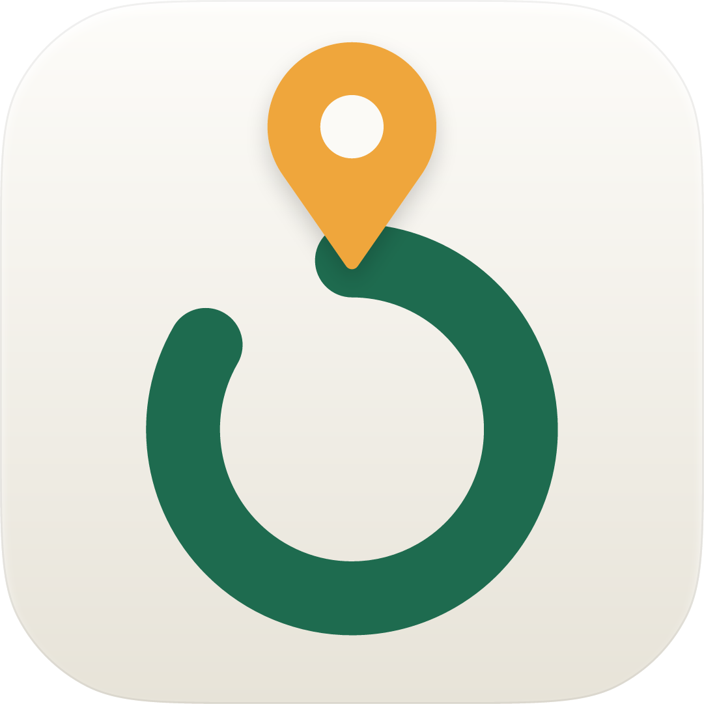
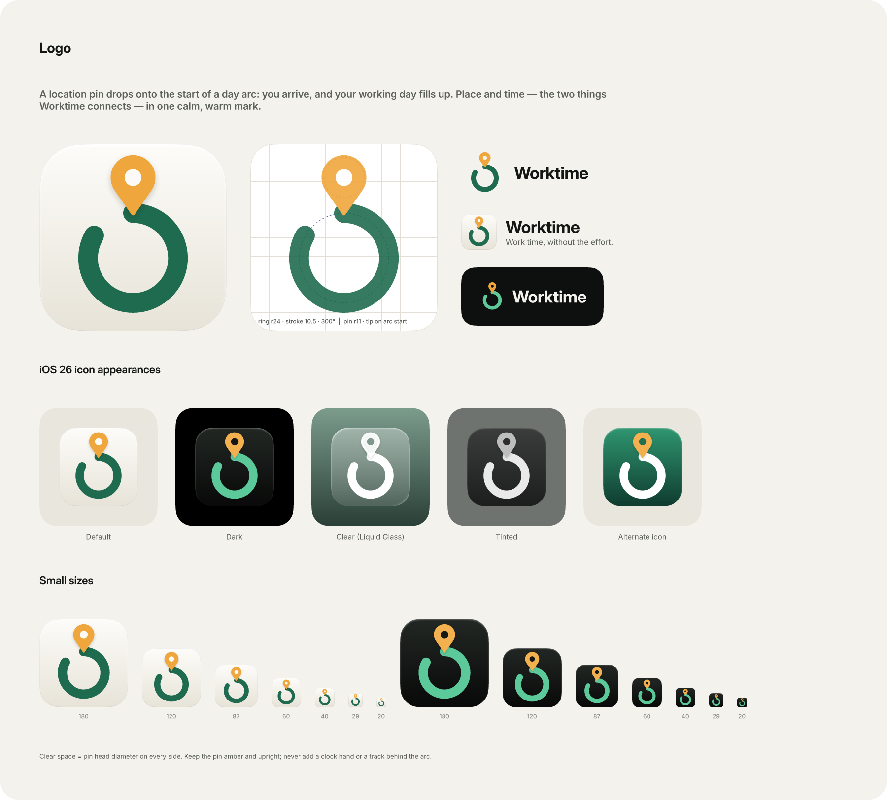

<p align="center">
  
</p>

<h1 align="center">Worktime</h1>

<p align="center">
  <b>Work time, without the effort.</b><br>
  A calm, privacy-first work-time tracker for iPhone, Apple Watch and the Lock Screen.
  It reminds you to clock in and out when you arrive at or leave work, and keeps a record you can always correct.
</p>

> **Status:** the product design is complete, and the iOS & Android app (Expo) is in progress.
> The adaptive geofencing engine and the Today flow work; Calendar editing, widgets and watch apps come next.


## The design

### Today, at a glance
The status pill says whether you're working. The timer shows for how long, and the day ribbon shows how
the day is going. One or two capsule buttons show what you can do next.


### Fix anything, and see the impact first
Missing check-outs show up in red. Every correction previews its effect on worked time and on your overtime
balance before you save it, and the original stays in the day's history.


### Reminders that ask, never assume
Geofences only fire when you arrive at or leave a workplace, and the result is always a question. The
detected time is offered as the answer. Home-office days use your weekly pattern instead of location.


### Apple Watch
Built for the wrist, not shrunk from the phone: a coloured glow shows the state, a large ring shows the day's
progress, and the actions sit in the corners where your thumb expects them.


### Widgets
Every widget family comes in light and dark. Live counting uses system timer text, and the buttons are
App Intents, so you can clock in or start a break without opening the app.


### Lock Screen, Dynamic Island, widgets in context


### Dark mode


### Logo
A location pin drops onto the start of a day arc. You arrive, and your working day fills up. Place and
time, the two things Worktime connects, in one warm mark. The default icon sits on warm paper; the dark,
clear (Liquid Glass) and tinted appearances and a green alternate icon are on the Brand page.



More: [all screens](design/exports/iphone), [watch](design/exports/watch), [widgets](design/exports/widgets),
[page overviews](design/exports/overview), [design system](design/exports/design-system).

## The app

```bash
npm install
npm test                       # geofence engine + time math (Vitest)
cd apps/mobile && npx expo run:ios   # or run:android (development build)
```

* **iPhone and Android phones**: one Expo codebase in `apps/mobile` ([README](apps/mobile/README.md)).
* **Widgets, Live Activity, Apple Watch, Wear OS**: thin surfaces that render a snapshot from the phone and send
  taps back ([surfaces](docs/technical/surfaces.md)). The Apple Watch app (SwiftUI) lives in `apps/mobile/targets`,
  the Wear OS app (Compose) in `apps/wear`. React Native doesn't run on watches.
* **Geofencing**: three rings per workplace. Far away nothing runs, approaching triggers a low-power check
  every few minutes, near the fence GPS runs every 20 to 90 s, and once inside it stops. Users decide when
  they're asked. A commute simulation needs 14 location fixes an hour instead of 720
  ([concept](docs/technical/geofencing.md)).

### Continue on a Mac

```bash
npm install                                   # repo root, npm 11
npm test && npm run typecheck                 # core + app logic
cd apps/mobile
npx expo start --web                          # quick UI preview in the browser (no location / notifications)
npx expo prebuild --clean                     # generates ios/ and android/ (not committed)
npx expo run:ios --device                     # iPhone dev build; set ios.appleTeamId in app.json first
npx expo run:android                          # Android dev build
xed ios                                       # Xcode: schemes Worktime, WorktimeWatch, ExpoWidgetsTarget
cd ../wear && ./gradlew installDebug          # Wear OS app (or open apps/wear in Android Studio)
```

Signing: the iPhone app, widget extension and both watch targets share the App Group `group.com.worktime.app`;
the Android phone and Wear OS apps must be signed with the same key. What has been verified where, and what
still needs a device, is listed per surface in [docs/technical/surfaces.md](docs/technical/surfaces.md).

## What's here

```
design/
  figcraft/worktime.figcraft      ← the editable design file (FigCraft, open source)
  figcraft/src/                   ← generator: build.py writes the .figcraft, export.py the PNGs
  exports/                        ← PNG previews (@2x) per area + page overviews
    iphone/{core,places,onboarding,states,dark,directions}
    watch/  widgets/ (+ widgets/gallery)  overview/  design-system/
    brand/                        ← app icon (PNG 1024, SVG), logo lockup SVG, README boards
  references/                     ← research reference previews
apps/mobile/                      ← Expo app (iOS + Android), Apple Watch targets, local native modules
apps/wear/                        ← Wear OS app (Kotlin, Compose for Wear OS, tile, complications)
packages/core/                    ← geofence engine + time tracking math, tested
docs/
  technical/geofencing.md         ← adaptive geofencing concept and numbers
  technical/architecture.md       ← Expo + native watches, sync, time zones, milestones
  technical/surfaces.md           ← widgets, Live Activity, Apple Watch, Wear OS: contract and status
  product/requirements.md         ← requirements → screens
  product/user-flows.md           ← six journeys + state model
  product/technical-constraints.md← iOS limits that shape the UX
  design/research.md              ← Kombai + Liquid Glass research
  design/design-system.md         ← tokens, type, components, icons (SF Symbol mapping)
  design/decisions.md             ← design decisions and trade-offs
packages/design-tokens/tokens.json← colours (light/dark), type, spacing, radii, icons
```

## Pages in `worktime.figcraft`

| Page | Contents |
|---|---|
| Cover | Overview |
| Brand | Logo (mark, construction, lockups, iOS 26 icon appearances, small sizes) and the README boards |
| Design System | Colour variables (Light/Dark), type and effect styles, spacing and radii, 109 icon components, UI components with variants |
| Flows | Six user-journey diagrams |
| iPhone · Core | Today (off / working / break), clock-in/out sheets, calendar, day details, edit, add missed day, weekly and monthly insights |
| iPhone · Places & Schedule | Settings, workplaces, add workplace, geofence radius, arrival/departure notifications, weekly pattern, reminders |
| iPhone · Onboarding | Welcome, working hours, location and notification permission explanations, workplace setup, completion |
| iPhone · System States | Empty, loading, permission denied, location unavailable, missed check-in, incomplete entry, conflict, confirmation and error |
| Apple Watch | Main, active, break, clock-out prompt, complications, arrival notification, today summary, Smart Stack widget, offline sync |
| Live Activity & Widgets | Lock Screen Live Activity and widgets, Dynamic Island (compact, minimal, expanded), Home Screen widgets in context |
| Geofencing | Workplace with approach/near/fence rings, arrival and departure rules, precision & battery profiles, how-it-works explainer, live location status |
| Android & Wear OS | Material 3 Today (light/dark), ongoing and location notifications, background-location permission, round Wear OS screens |
| Widgets | Every widget family, light and dark: small (not working, working, break, interactive clock-in), medium (today, week), large (week), Lock Screen accessories, Control Center controls, clear style, StandBy |
| Directions | The three explored visual directions |
| Dark Mode | Key screens in dark appearance |

The main journeys are linked in FigCraft's Prototype tab (onboarding chain, clock in, break, clock out,
fixing a missing day).

## Working with the designs

FigCraft is an open-source design app (<https://github.com/storytold/figcraft>). Open the file in the desktop
app, or work headless with the CLI:

```bash
cd design/figcraft/src
python3 build.py screens_core screens_places screens_onboarding screens_apple screens_geo flows brand   # regenerate .figcraft
python3 export.py                                                                      # regenerate PNGs
```

`build.py` needs `figcraft-cli` on the `PATH`. The README boards on the Brand page embed the PNGs from the
previous export, so run build + export twice after changing screens. The document is generated from code, so make changes in
`design/figcraft/src/` and rebuild. Hand edits made in FigCraft get overwritten on the next build unless
you port them back to the generator.

## Recommended implementation sequence
1. **Domain core** (`packages/core`): event log, session/day derivation, balance, time zones, break rules (unit tested).
2. **Expo app shell**: tabs, design tokens, Today with manual clock in/out/break, SQLite persistence.
3. **Calendar & corrections**: day details, edit/add/delete with impact preview, history, conflict detection.
4. **Notifications + geofencing** (Swift module): region monitoring, debounce, actionable notifications, reconciliation.
5. **Insights**: week/month, charts.
6. **Widgets & Live Activity** (WidgetKit/ActivityKit + App Intents).
7. **Apple Watch** (SwiftUI + WatchConnectivity) and complications.
8. **Onboarding, export/backup, accessibility pass** (Dynamic Type, VoiceOver, Reduce Transparency).

## Credits
Icons: [Phosphor Icons](https://phosphoricons.com) (MIT) as design stand-ins for SF Symbols.
Typeface in the design files: Inter (OFL) as a stand-in for SF Pro.
